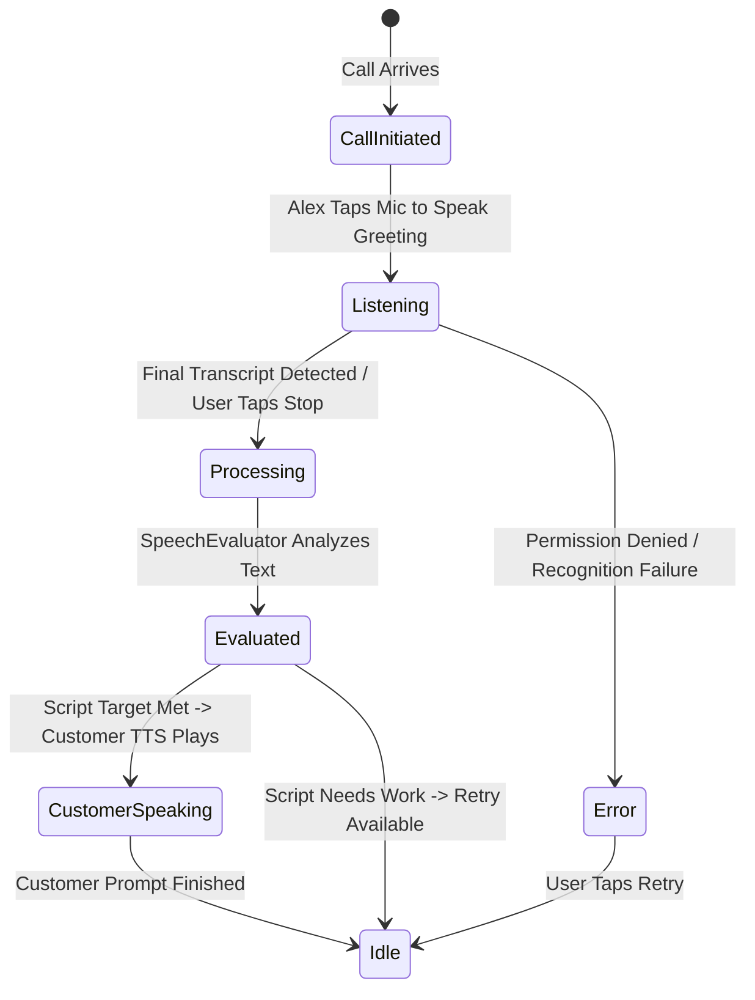

# ARCHITECTURE.md — System Architecture, Audio Pipeline & Data Flow

This document defines the software architecture, data flow, audio lifecycle, and state machine conventions of CALLFORGE.

---

## 1. Clean Layered Architecture

CALLFORGE maintains a strict layered Clean Architecture:

```
lib/
├── core/
│   ├── audio/           # Speech synthesis, recognition, and lifecycle orchestration
│   ├── constants/       # Provenance tokens, strings, and theme definitions
│   ├── evaluation/      # Text matching, Levenshtein, WER, and coaching generation
│   └── theme/           # Premium dark theme design system
├── data/
│   ├── datasources/     # SharedPreferences local attempt storage
│   ├── models/          # Data transfer objects with JSON serialization
│   └── repositories/    # Implementation of domain repository contracts
├── domain/
│   ├── entities/        # Pure domain models (Scenario, EvaluationResult)
│   └── repositories/    # Abstract interfaces for data access
└── presentation/
    ├── controllers/     # UI state management (SimulatorController)
    ├── screens/         # SimulatorScreen, HistoryScreen
    └── widgets/         # MicControlButton, CoachingCard, SimulatedWaveformVisualizer
```

---

## 2. Audio Pipeline & Speech Lifecycle

### 2.1. Inbound Simulation State Machine
The simulation operates on a turn-based state machine where the representative opens the call:



### 2.2. Audio Components:
1. **`ISpeechService`**: Abstract contract for speech synthesis, recognition, and error handling.
2. **`NativeSpeechService`**:
   - Integrates `flutter_tts` for `en-US` customer speech.
   - Integrates `speech_to_text` for Alex's microphone recognition.
   - Implements error recovery: catches recognition timeouts, network requirements, and permission rejections without crashing.
   - Implements safety watchdog: if `status == 'notListening'` occurs without a final transcript callback, safely resets or prompts the user rather than leaving the UI stuck in `processing`.
3. **`MockSpeechService`**: Provides a deterministic, testable speech implementation for automated CI and widget testing.

---

## 3. Visual Feedback & Simulated Waveforms

- **Audio Activity Indicator**: The UI displays an animated waveform during listening and speaking states.
- **Architectural Fact**: This visualizer is a **simulated activity indicator** driven by state transitions. It is intentionally decoupled from raw PCM microphone amplitude sampling to prevent platform channel overhead and battery drain on low-RAM physical devices.

---

## 4. Local Data Persistence

- All attempt records are persisted offline using `SharedPreferences`.
- Schema:
  - `id`: Unique attempt ID (timestamp-based)
  - `scenarioId`: Scenario identifier
  - `timestamp`: ISO-8601 string
  - `transcript`: Exact recognized speech string
  - `accuracyPercentage`: Normalized text similarity percentage (0–100%)
  - `passed`: Boolean indicating if script target and anchors were met
  - `wpm`: Estimated session pace
  - `missingAnchors`: Missing required semantic tokens
  - `pbErrors`: Detected words with P/B substitutions
  - `arabicCoaching`: Egyptian Arabic coaching text
