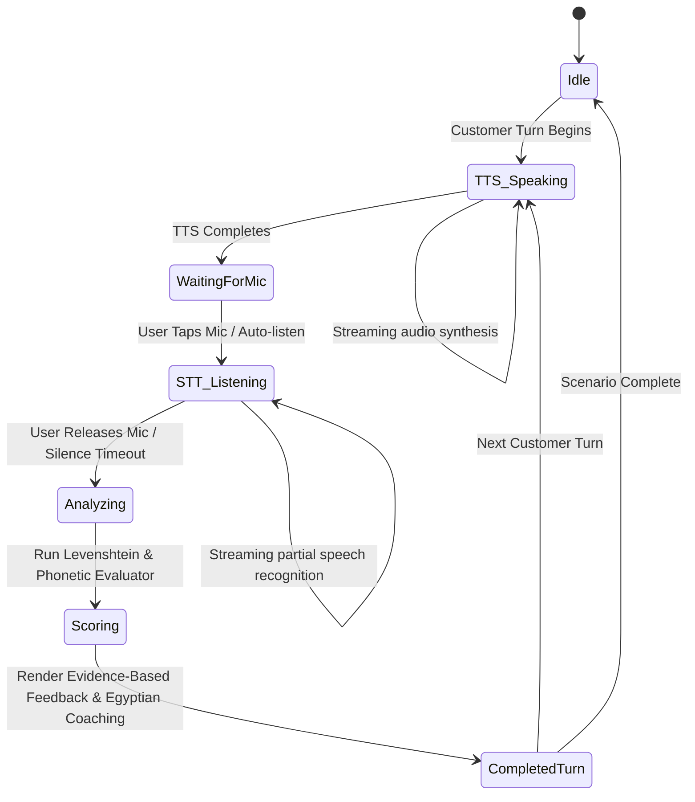

# ARCHITECTURE.md — System Architecture & Audio Pipeline

This document defines the high-level software architecture, data flows, audio pipeline, and state management conventions of CALLFORGE.

---

## 1. Clean Layered Architecture

CALLFORGE strictly follows Clean Architecture principles to separate business rules from Flutter UI rendering and platform hardware:

```
lib/
├── core/
│   ├── audio/           # Low-level audio session & audio focus management
│   ├── constants/       # App constants, design tokens, strings (EN & AR)
│   ├── theme/           # Premium dark theme design system
│   └── utils/           # Text comparison, Levenshtein, WPM calculation
├── data/
│   ├── datasources/     # Local database, SharedPreferences, asset loaders
│   ├── models/          # Data transfer objects & JSON mapping
│   └── repositories/    # Implementation of domain repositories
├── domain/
│   ├── entities/        # Immutable domain models (Scenario, Turn, Assessment)
│   ├── repositories/    # Abstract interfaces for data access
│   └── usecases/        # Single-responsibility business logic use cases
└── presentation/
    ├── providers/       # State management controllers / ValueNotifiers / Cubits
    ├── screens/         # High-level route screens
    └── widgets/         # Reusable UI components (MicButton, AudioWaveform, CoachingCard)
```

### Architectural Rules:
1. **Domain Layer Independence**: The `domain` layer has zero dependencies on Flutter, Android platform channels, or external database packages. It can be tested purely with pure Dart unit tests.
2. **Repository Pattern**: All data retrieval (curriculum scenarios, practice history, user scores) goes through abstract repository contracts.
3. **Reactive State**: Presentation uses lightweight reactive state management (e.g. Flutter `ChangeNotifier` / `ValueNotifier` / Riverpod / Bloc) that minimizes rebuilds and avoids memory leaks.

---

## 2. Audio & Speech Pipeline Architecture

The voice subsystem coordinates native Android Speech-to-Text and Text-to-Speech through a disciplined state machine:



### Audio Components:
1. **TTS Service (`TtsService`)**:
   - Manages `flutter_tts` instance.
   - Enforces `en-US` language voice profile.
   - Provides hooks for `onStart`, `onCompletion`, and `onError`.
   - Regulates customer speaking rate (0.45 to 0.55 depending on emotional urgency).
2. **STT Service (`SttService`)**:
   - Manages `speech_to_text` instance.
   - Handles runtime permissions (`Permission.microphone`).
   - Listens with `en_US` locale ID.
   - Emits partial and final recognized speech strings.
   - Handles acoustic silence detection and device recognizer timeouts without crashing.
3. **Audio Session Coordinator (`AudioSessionCoordinator`)**:
   - Manages audio focus transitions on Android so TTS playback does not echo into the microphone STT stream.

---

## 3. Evaluation & Phonetic Analysis Engine

Rather than relying on opaque cloud APIs or hallucinated pronunciation scores, CALLFORGE uses a deterministic, evidence-based evaluation engine:

1. **Normalized Levenshtein Similarity**:
   - Strips punctuation, normalizes case and spacing.
   - Computes edit distance between expected verbatim phrase and recognized text.
   - Formula:
     $$\text{Similarity}(S_1, S_2) = 1 - \frac{\text{Levenshtein}(S_1, S_2)}{\max(|S_1|, |S_2|)}$$
2. **Keyword & Compliance Audit**:
   - Confirms presence of mandatory call center anchors (e.g. for greeting: `"AT&T"`, `"Alex"`, `"first"`, `"last"`, `"name"`).
3. **Phonetic Anchor Target (P vs. B Transfer Detector)**:
   - Arabic native speakers frequently neutralize `/p/` to `/b/` due to phonemic transfer.
   - Target lexicon: `plan` ↔ `blan`, `pay` ↔ `bay`, `payment` ↔ `bayment`, `problem` ↔ `broblem`, `price` ↔ `brice`, `paperless` ↔ `baperless`.
   - Flags acoustic misrecognitions and highlights specific phonetic mouth-shape guidance in Egyptian Arabic.

---

## 4. Local Persistence Schema

Local-first data storage uses lightweight key-value / SQLite storage:
- **`user_profile`**: Stores agent alias (`Alex`), target metrics, current day in 90-day plan.
- **`scenario_attempts`**:
  - `id`: UUID
  - `scenario_id`: String
  - `timestamp`: ISO-8601
  - `raw_transcript`: String
  - `accuracy_score`: Double
  - `wpm`: Integer
  - `phonetic_errors`: List<String>
  - `passed`: Boolean
- **`module_progress`**: Tracks unlocked levels, streak days, and competency mastery.

---

## 5. Low-RAM Development Optimization

Given the development host environment (Windows PC with 8 GB RAM):
- **Gradle JVM Heap**: Set to `org.gradle.jvmargs=-Xmx2048m -XX:MaxMetaspaceSize=512m` in `android/gradle.properties`.
- **Flutter Build**: Run tests headlessly (`flutter test`) without GUI overhead.
- **Physical Device**: Real Android hardware attached via USB debugging (ADB) bypasses the memory-intensive Android Studio Emulator (which typically consumes 3–4 GB of system RAM).
