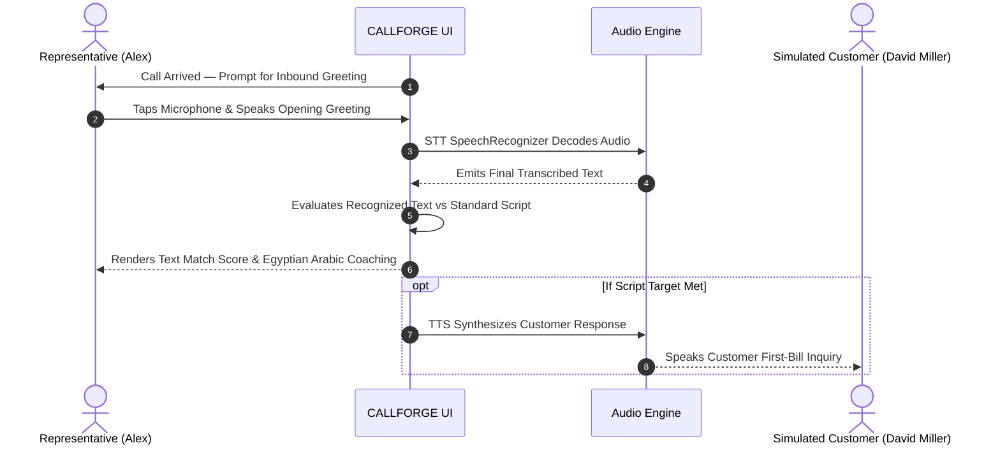
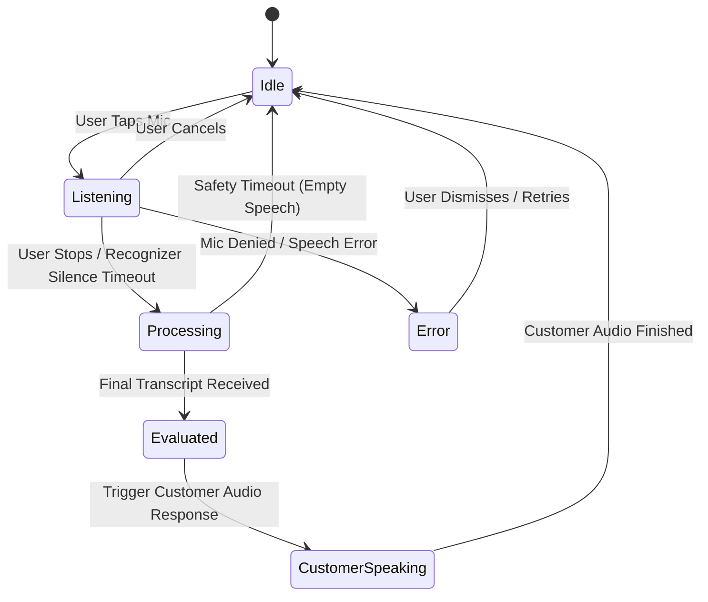

# VOICE_STRATEGY.md — Speech Pipeline, Evaluation Integrity, & Audio Realities

This document specifies the technical architecture, operating boundaries, evaluation logic, and linguistic strategies for the CALLFORGE voice subsystem.

---

## 1. Principles of Voice Truth in CALLFORGE

1. **Recognized-Text Matching $\neq$ Acoustic Pronunciation Analysis**:
   - The Android speech recognition engine (`android.speech.SpeechRecognizer`) performs speech-to-text decoding and outputs a string of recognized tokens.
   - It **does not** output acoustic formants, spectrograms, or phoneme-level confidence scores.
   - Therefore, CALLFORGE evaluates **Recognized-Text Similarity** against target training scripts. It does **not** claim to measure acoustic native accent percentages or acoustic pronunciation precision.
2. **Turn-Based Operation (Push-to-Talk / Tap-to-Speak)**:
   - Mobile speech recognizers are engineered for short turn-based utterances, not indefinite continuous streaming.
   - The simulation flow is structured as discrete audio turns: the representative taps to speak their turn, and the customer responds via Text-to-Speech.
3. **Conditional Offline Availability**:
   - Android Text-to-Speech (`flutter_tts`) runs completely offline using local system voice data.
   - Android Speech-to-Text (`speech_to_text`) works offline **only if** the physical Android device has the English (US) offline speech package pre-installed in Google Speech Services (`Settings > Google > Speech Services > Offline speech recognition`).
   - If the offline model is missing and the device has no network, the Android recognizer will emit an error (`error_network` or `error_server`). The app must catch this error and inform the user clearly rather than hanging.

---

## 2. Inbound Simulation Turn Architecture

In real-world AT&T call center operations, the representative answers the incoming call first. The M1 simulation models this exact sequence:

---

## 3. Evaluation & Scoring Engine (Text-Matching Integrity)

### 3.1. Recognized-Text Similarity (Normalized Levenshtein Distance)
For standard scripts and mandatory phrases:
- Text is normalized (lowercase, punctuation removed, whitespace collapsed).
- Levenshtein edit distance computes character-level transformations:
  $$\text{Similarity}(S_{\text{cand}}, S_{\text{ref}}) = 1.0 - \frac{\text{Levenshtein}(S_{\text{cand}}, S_{\text{ref}})}{\max(|S_{\text{cand}}|, |S_{\text{ref}}|)}$$
- Clearly labeled in the UI as **Recognized-Text Similarity**, not acoustic pronunciation.

### 3.2. Mandatory Semantic Anchors
For the standard greeting:
- Reference: *"Hello, thank you for calling AT&T. This is Alex. May I have your first and last name, please?"*
- Mandatory anchors required for script target: `att` (or `at&t`), `alex`, `first`, `last`, `name`.
- Script Target Met requires: Similarity $\ge 70\%$ **and** $0$ missing semantic anchors.

### 3.3. Token Error Rate (Word Error Rate - WER)
Measures word substitutions, deletions, and insertions:
$$\text{WER} = \frac{S + D + I}{N}$$
Where $N$ is the count of words in the reference script.

### 3.4. Estimated Session Speaking Pace
- Pace is calculated from total words divided by active session duration:
  $$\text{Pace (Tokens/Min)} = \frac{\text{Words}}{\text{Duration (seconds)}} \times 60$$
- This is an approximate conversational pace indicator, not an acoustic syllable-per-second speech measurement.

### 3.5. Phonemic Contrast Awareness (P vs. B)
- In Egyptian Arabic phonology, `/b/` is a native voiced stop, while `/p/` is absent in classical phonology, leading to frequent transfer substitutions.
- CALLFORGE inspects the transcribed text for recognized words where a `/p/` word was expected but a known `/b/` substitution was decoded by the speech engine (e.g. `blan` for `plan`, `bayment` for `payment`, `broblem` for `problem`).
- When detected, the engine surfaces an educational coaching alert in Egyptian Arabic reminding Alex to aspirate the bilabial voiceless stop `/p/`.
- **Integrity Rule**: This is an educational awareness heuristic based on text output, not an acoustic phoneme diagnostic.

---

## 4. Audio Engine State Machine & Error Recovery

### Error Recovery Matrix:
| Event | Engine Behavior | User Guidance (UI) |
| :--- | :--- | :--- |
| **Microphone Permission Denied** | State transitions to `error` | Explains permission is required with link to system settings. |
| **No Speech Detected (Silence)** | Recognizer times out, resets to `idle` | Prompts user to speak clearly into microphone. |
| **Offline Recognizer Missing** | Catches `error_network` or `error_server` | Explains offline speech model is missing and prompts user to download English (US) offline speech package or connect to internet. |
| **Engine Busy / Hardware In Use** | Stops active audio focus, resets to `idle` | Prompts user to retry. |
